# Soi Hợp Đồng Trọ: app đọc hợp đồng thuê trọ cho sinh viên

> Sinh viên chụp hợp đồng thuê trọ (in hoặc viết tay). Trong vài phút, app chỉ ra điều khoản rủi ro hoặc còn thiếu, tô đúng dòng trên ảnh, giải thích bằng tiếng Việt dễ hiểu và soạn sẵn câu hỏi gửi chủ nhà.
>
> **App không phải tư vấn pháp lý.** Sinh viên duyệt từng cảnh báo trước khi gửi bất cứ điều gì.

**Trạng thái (14/11/2026):** chạy được trọn luồng trên điện thoại thật qua Expo Go, gọi backend chung trên Render. Còn thiếu: bộ kiểm thử có nhãn (`eval/`), che CCCD và số điện thoại, bản phát hành cho người ngoài nhóm. Xem [mục 9](#9-tiến-độ-và-việc-còn-lại).

- Backend: `https://rental-contract-api.onrender.com` (gói miễn phí, lần gọi đầu sau 15 phút nghỉ mất khoảng 1 phút)
- Bản kế hoạch cả nhóm cùng sửa và bình luận: [Claude Docs](https://claude.ai/artifact/K8m3iE7C2ruwwLZxEMVjci)

## Mục lục

1. [Bài toán và giá trị của AI](#1-bài-toán-và-giá-trị-của-ai)
2. [Quyết định kiến trúc: tô đúng dòng trên ảnh](#2-quyết-định-kiến-trúc-tô-đúng-dòng-trên-ảnh)
3. [Luồng xử lý](#3-luồng-xử-lý)
4. [Các màn hình](#4-các-màn-hình)
5. [Công nghệ và cấu trúc repo](#5-công-nghệ-và-cấu-trúc-repo)
6. [Bộ kiến thức: checklist và căn cứ pháp lý](#6-bộ-kiến-thức-checklist-và-căn-cứ-pháp-lý)
7. [Chống AI đọc sai và bịa](#7-chống-ai-đọc-sai-và-bịa)
8. [Quyền riêng tư và AI có trách nhiệm](#8-quyền-riêng-tư-và-ai-có-trách-nhiệm)
9. [Tiến độ và việc còn lại](#9-tiến-độ-và-việc-còn-lại)
10. [Bắt đầu làm việc với repo](#10-bắt-đầu-làm-việc-với-repo)

## 1. Bài toán và giá trị của AI

- **Người dùng:** sinh viên lần đầu thuê trọ ở Hà Nội, không đủ tiền thuê luật sư, không biết thế nào là "bình thường".
- **Hậu quả cần tránh:** mất tiền cọc, tranh chấp tiền điện nước, sửa chữa, chấm dứt hợp đồng sớm.
- **Vì sao AI là thiết yếu:** bỏ AI đi thì sản phẩm không còn tồn tại. AI làm những việc sinh viên không tự làm được: đọc chữ viết tay, đối chiếu điều khoản với rủi ro, giải thích bằng chính số tiền của họ, soạn câu để thương lượng.
- **Ranh giới:** app không phải tư vấn pháp lý. Sinh viên duyệt từng cảnh báo trước khi gửi.

## 2. Quyết định kiến trúc: tô đúng dòng trên ảnh

Model AI đọc ảnh rất tốt nhưng không trả về vị trí trên ảnh đủ chính xác. Vì vậy ta chia việc cho OCR và LLM:

1. **OCR** (Google Cloud Vision) đọc ảnh, trả về từng dòng chữ kèm vị trí. Mỗi dòng có một mã, ví dụ `p1-L12` (trang 1, dòng 12).
2. **LLM** nhận ảnh cùng danh sách dòng có mã, và chỉ trả lời bằng **mã dòng** cộng **câu trích nguyên văn**.
3. **App** dùng vị trí OCR để tô sáng dòng đó trên ảnh.
4. **Code tự kiểm tra lại:** mã dòng có tồn tại không, câu trích có khớp với chữ trên dòng không. Không khớp thì hạ độ tin cậy hoặc bỏ cảnh báo.

Cảnh báo loại "thiếu điều khoản" không có dòng để tô, nên hiển thị thành thẻ riêng kèm đề xuất câu nên bổ sung.

## 3. Luồng xử lý

```mermaid
flowchart LR
    A[Chụp ảnh<br/>tối đa 8 trang] --> B1[B1 · OCR<br/>dòng chữ + vị trí]
    B1 --> B2[B2 · LLM đọc<br/>sửa OCR, trích số, phí khác]
    B2 -->|trang khó đọc| B2b[B2b · LLM đọc lại<br/>từng trang từ ảnh]
    B2b --> B3
    B2 --> B3[B3 · Quy tắc<br/>code kiểm tra]
    B3 --> B4[B4 · LLM rủi ro<br/>cảnh báo + mã dòng]
    B4 --> R[Duyệt cảnh báo<br/>Giữ / Bỏ qua / Sửa câu hỏi]
    R --> B5[B5 · LLM soạn tin<br/>chỉ cảnh báo đã giữ]
    B5 --> Z[Sao chép hoặc chia sẻ<br/>sinh viên tự gửi]

    classDef llm fill:#e3eefc,stroke:#2f6fd6
    class B2,B2b,B4,B5 llm
```



- **B1 · OCR:** Google Vision `DOCUMENT_TEXT_DETECTION`. Backend tự ghép từ thành dòng và gộp các mảnh cùng hàng.
- **B2 · Đọc và trích xuất:** sửa lỗi OCR dựa vào ảnh, trích 8 khoản chính (tiền thuê, cọc, giá điện, giá nước và cách tính, phí dịch vụ, thời hạn, số ngày báo trước). B2 còn trích danh sách mở **các khoản phí khác** như wifi, gửi xe, rác, vệ sinh, thang máy, máy giặt, phí quản lý.
- **B2b · Đọc lại trang khó đọc:** chỉ chạy khi một trang có nhiều dòng OCR đọc sai số (thường là chữ viết tay). Ảnh trang đó được gửi riêng cho LLM đọc lại. Mỗi con số phải được 2 trong 3 lần đọc (OCR, B2, đọc lại) đồng ý. Vẫn khó đọc thì app báo chụp lại, không trả "0 cảnh báo".
- **B3 · Quy tắc bằng code:** cọc vượt mức tham khảo, giá điện vượt mức quy định, không ghi thời hạn báo trước.
- **B4 · Phân tích rủi ro:** LLM đối chiếu hợp đồng với checklist, giải thích bằng số tiền thật của sinh viên.
- **B5 · Soạn tin:** chỉ chạy sau khi sinh viên duyệt, theo xưng hô (em – anh/chị, cháu – cô/chú) và giọng (nhẹ nhàng, thẳng thắn) đã chọn.

Có ba chế độ LLM, chọn bằng `LLM_PROVIDER`: `openai` (đang dùng trên Render, `gpt-4.1-mini`), `claude`, và `none` (không AI: đọc khoản chính, phí khác và cảnh báo bằng từ khóa, dùng làm phương án dự phòng khi demo).

Trên hợp đồng in thật, một lượt phân tích mất khoảng 20–40 giây và ra 5–14 cảnh báo. Trang viết tay có thêm bước B2b, tốn thêm khoảng 5–10 giây mỗi trang.

## 4. Các màn hình

| Màn | File | Nội dung |
| --- | --- | --- |
| Giới thiệu | `app/index.tsx` | Câu "không phải tư vấn pháp lý", cách xử lý ảnh, ô đồng ý |
| Chụp | `app/capture.tsx` | Chụp bằng camera hoặc chọn từ thư viện, nhiều trang, xem lại và xóa từng trang |
| Đang phân tích | `app/analyzing.tsx` | Các bước "Đọc chữ → Trích điều khoản → Kiểm tra rủi ro", báo lỗi rõ (ảnh khó đọc, không phải hợp đồng, quá nhiều trang, mất mạng, quá thời gian) |
| Tổng quan | `app/overview.tsx` | Số điểm và tiến độ duyệt, dải chip các khoản chính và phí khác (chạm để mở bảng đầy đủ), ảnh thu nhỏ các trang có đánh số từng điểm |
| Chi tiết cảnh báo | `app/flag/[id].tsx` | Ảnh trang tự phóng vào dòng được tô, câu hỏi cho chủ nhà (sửa được), nút Giữ / Bỏ qua, giải thích và câu đề nghị ghi vào hợp đồng |
| Tin nhắn | `app/message.tsx` | Chọn xưng hô và giọng, sao chép hoặc chia sẻ sang Zalo |

Mục không ghi hoặc ghi chưa rõ trong hợp đồng có nền vàng. Cảnh báo có độ tin cậy thấp ghi "AI không chắc, bạn nên đọc lại dòng gốc".

## 5. Công nghệ và cấu trúc repo

Toàn bộ viết bằng TypeScript để app và backend dùng chung schema.

| Lớp | Dùng | Ghi chú |
| --- | --- | --- |
| App di động | Expo SDK 58 (React Native), Expo Router, Zustand | Chạy trong Expo Go |
| Chụp ảnh | `expo-camera`, `expo-image-picker`, `expo-image-manipulator` | Chưa có tự cắt viền: thư viện quét tài liệu cần bản build riêng, không chạy trong Expo Go |
| Tô sáng dòng | `react-native-svg` | Vẽ khung lên ảnh theo vị trí OCR |
| Backend | Node 22 + Hono | API key chỉ ở backend, không bao giờ đưa vào app |
| OCR | Google Cloud Vision (REST, API key hoặc service account) | |
| LLM | OpenAI `gpt-4.1-mini` (Responses API, `store: false`) hoặc Claude | Đầu ra ép đúng JSON schema (structured outputs) |
| Kiểm tra dữ liệu | Zod, dùng chung app và backend (`packages/shared`) | |
| Deploy backend | Render (`render.yaml`), vùng Singapore | Tự deploy khi push nhánh `api/backend` có sửa phần backend |

```
apps/mobile/            # Expo app (6 màn hình)
apps/api/               # Backend Hono: OCR, pipeline B1–B5, chế độ không AI
packages/shared/        # Zod schema dùng chung, quy tắc B3, kiểm tra câu trích
data/checklist.yaml     # 21 quy tắc rủi ro kèm căn cứ pháp lý
data/market_norms.yaml  # Ngưỡng theo luật và quy tắc tham khảo của app
data/samples/           # Hợp đồng mẫu ĐÃ che thông tin (raw/ bị gitignore)
eval/                   # Bộ kiểm thử + nhãn đúng (chưa có dữ liệu)
prompts/                # 4 prompt: 01-extract, 02-risk, 03-message, 04-reread
docs/DEPLOY.md          # Deploy Render, cài cho thành viên mới, lưu ý demo
docs/PHAP_LY.md         # Báo cáo căn cứ pháp lý và số liệu thị trường
docs/bao-cao-app.md     # Báo cáo phần app
render.yaml             # Cấu hình Render (Blueprint)
```

## 6. Bộ kiến thức: checklist và căn cứ pháp lý

Chất lượng app phụ thuộc vào checklist nhiều hơn vào code. Căn cứ pháp lý được đối chiếu ngày 14/11/2026 và ghi trong trường `legal_basis` của từng quy tắc, kèm mức xác minh: văn bản gốc, toàn văn không chính thức, báo chí, hoặc [QUY TẮC APP] khi không có căn cứ pháp lý. Chi tiết và nguồn ở [`docs/PHAP_LY.md`](docs/PHAP_LY.md).

| Mã | Nhóm | Quy tắc | Mức | Ai kiểm tra |
| --- | --- | --- | --- | --- |
| DEP-01 | Cọc | Không ghi điều kiện hoặc thời hạn trả cọc | Cao | AI (B4) |
| DEP-02 | Cọc | "Mất cọc trong mọi trường hợp" khi trả phòng sớm, kể cả đã báo trước | Cao | AI (B4) |
| DEP-03 | Cọc | Được trừ cọc vì "hư hỏng" nhưng không có biên bản bàn giao hiện trạng | Cao | AI (B4) |
| DEP-04 | Cọc | Cọc cao hơn mức tham khảo | TB | Code (B3) |
| UTL-01 | Điện nước | Ghi "giá điện theo chủ nhà quy định" hoặc cao hơn mức quy định cho người thuê | Cao | Code (B3) |
| UTL-02 | Điện nước | Phí dịch vụ không ghi gồm những gì; nước tính theo người hay theo khối không rõ | TB | AI (B4) |
| UTL-03 | Điện nước | Tiền điện tính khoán, không gắn với công tơ hay hóa đơn, không cho người thuê xem hóa đơn | TB | AI (B4) |
| RNT-01 | Tiền thuê | Chủ nhà được tăng giá bất kỳ lúc nào, không báo trước | Cao | AI (B4) |
| RNT-02 | Tiền thuê | Phạt chậm trả quá nặng | TB | AI (B4) |
| RNT-03 | Tiền thuê | Giá thuê "chưa gồm thuế" hoặc người thuê phải chịu thuế cho thuê nhà | Thấp | AI (B4) |
| REP-01 | Sửa chữa | Người thuê chịu mọi khoản sửa chữa, kể cả hư hỏng lớn hoặc hao mòn tự nhiên | Cao | AI (B4) |
| TRM-01 | Chấm dứt | Chủ nhà được tự ý chấm dứt không cần báo trước, còn người thuê thì mất cọc | Cao | AI (B4) |
| TRM-02 | Chấm dứt | Không ghi thời hạn báo trước | TB | Code (B3) |
| TRM-03 | Chấm dứt | Chủ nhà được chấm dứt, khóa cửa hoặc dọn đồ khi người thuê chậm tiền dưới 3 tháng | Cao | AI (B4) |
| OTH-01 | Khác | Không có danh sách đồ đạc hoặc biên bản hiện trạng | TB | AI (B4) |
| OTH-02 | Khác | Chủ nhà được vào phòng bất kỳ lúc nào | Cao | AI (B4) |
| OTH-03 | Khác | Không rõ người cho thuê có phải chủ nhà thật không, hoặc thiếu họ tên, số định danh của bên cho thuê | TB | AI (B4) |
| OTH-04 | Khác | Không nhắc tới đăng ký tạm trú | TB | AI (B4) |
| OTH-05 | Khác | Cấm hoặc không hỗ trợ đăng ký tạm trú, thu phí "làm tạm trú" | TB | AI (B4) |
| OTH-06 | Khác | Giữ CCCD gốc, thu ảnh CCCD không nói rõ mục đích hoặc thời gian lưu | TB | AI (B4) |
| OTH-07 | Khác | Người thuê chịu toàn bộ trách nhiệm cháy nổ, không ghi ai lo thiết bị phòng cháy | TB | AI (B4) |

Các điểm chính rút ra từ việc đối chiếu luật:

- **Căn cứ chính:** Luật Nhà ở 2023 (27/2023/QH15) cho các vấn đề thuê nhà ở, Bộ luật Dân sự 2015 cho phần chung (đặt cọc Điều 328, thuê tài sản Điều 472–482).
- **Cọc được thỏa thuận:** luật không đặt trần tiền cọc và cho hai bên tự thỏa thuận về mất cọc. App khuyên thương lượng, không nói "trái luật".
- **Căn cứ cứng nhất:**
  - Chủ nhà chỉ được đơn phương chấm dứt trong các trường hợp Luật Nhà ở liệt kê, và phải báo trước 30 ngày (Điều 172).
  - Thu tiền điện cao hơn quy định có thể bị phạt 20–30 triệu đồng (Nghị định 133/2026, Điều 13 khoản 7).
- **Không cảnh báo** các điểm sau, vì đã kiểm tra là không có căn cứ: hợp đồng không công chứng; phòng dưới 8 hoặc 15 m²/người (ngưỡng này chỉ dành cho thường trú); chủ trọ chưa lập doanh nghiệp.

Ngưỡng trong [`data/market_norms.yaml`](data/market_norms.yaml):

| Trường | Giá trị | Nguồn |
| --- | --- | --- |
| `electricity_max` | 2.472 đ/kWh | Giá bậc 2 (2.289 đ chưa VAT, QĐ 2892/QĐ-BCT từ 01/11/2026, Thông tư 60/2025) × VAT 8%. Hợp đồng từ 12 tháng thì app chỉ gợi ý hỏi cách tính, vì chủ nhà có thể đã kê khai định mức |
| `deposit_months_max` | 2 tháng | Quy tắc tham khảo của app, không phải luật |
| `notice_days_typical` | 30 ngày | Mặc định của Luật Nhà ở 2023 Điều 172 khoản 4 |
| Các trường `*_typical` khác | `null` | Không có khảo sát đáng tin. Cố ý không điền giá điện "hay gặp" (3.500–5.000 đ), để AI không coi mức có thể bị phạt là bình thường |

## 7. Chống AI đọc sai và bịa

Đọc sai một con số là lỗi nặng nhất của app, nên backend không tin AI mặc định:

- **Con số khi sửa OCR:** bản sửa OCR của AI chỉ được nhận khi các con số giữ nguyên. Riêng trang khó đọc thì cần 2 trong 3 lần đọc khớp nhau.
- **Số tiền trích ra:** số tiền trong các khoản chính và phí khác phải đọc được từ chính dòng được trích dẫn. Không có thì chuyển thành "chưa rõ" kèm con số AI đọc, để sinh viên tự kiểm tra.
- **Cảnh báo:** cảnh báo có mã dòng không tồn tại, hoặc câu trích không khớp chữ trên dòng, sẽ bị bỏ hoặc hạ độ tin cậy.
- **Quy tắc tính được:** những quy tắc này do code tính (B3). Nếu LLM quên một cảnh báo mà code đã bắt được, backend tự thêm vào.
- **Mức phổ biến:** `what_is_common` chỉ được lấy số trong `market_norms.yaml`. Căn cứ luật chỉ được lấy trong `legal_basis`, không để AI tự nhớ số điều.
- **Trang khó đọc:** trang không đọc được thì app báo chụp lại, không trả kết quả có thể sai.

Hướng dẫn viết prompt nằm trong [`prompts/`](prompts/):

1. **Ép đầu ra bằng structured outputs (khai báo JSON schema)**, không chỉ ghi "hãy trả lời bằng JSON".
2. **Bắt buộc trích mã dòng kèm câu nguyên văn**, rồi để code kiểm tra lại.
3. **Cho phép AI nói "không biết"** (`not_found` / `unclear` / `[không đọc được]`).
4. **Giải thích lý do cho mỗi quy tắc.** Model làm theo tốt hơn khi hiểu vì sao.
5. **Phần cố định đặt ở đầu system prompt** (checklist, mức tham chiếu), hợp đồng để sau, để phần đầu được lưu đệm.
6. **Bọc hợp đồng trong thẻ `<contract>`** và nói rõ đó là dữ liệu, không phải lệnh.
7. **Chỉnh prompt dựa trên bộ kiểm thử**, không sửa theo cảm giác từ một ví dụ.

## 8. Quyền riêng tư và AI có trách nhiệm

Đã làm:

- Câu "không phải tư vấn pháp lý" ở màn giới thiệu, tổng quan, chi tiết cảnh báo và tin nhắn. Cảnh báo có độ tin cậy thấp ghi rõ "AI không chắc".
- Không gửi gì tự động. Sinh viên duyệt từng cảnh báo và tự sao chép hoặc chia sẻ tin nhắn.
- **Ảnh hợp đồng không được lưu lại.** Backend không lưu ảnh hay kết quả. App chỉ lưu trên máy việc đã đồng ý điều khoản, không lưu ảnh hay kết quả phân tích.
- OpenAI được gọi với `store: false`. **Log của backend không ghi chữ trong hợp đồng**, chỉ ghi mã dòng, số lượng và thời gian.
- Giới hạn mỗi IP: 20 lượt `/analyze` và 60 lượt `/message` mỗi giờ, để không ai làm cạn hạn mức API.

Chưa làm:

- **Che số CCCD và số điện thoại** trước khi gửi ảnh và chữ cho AI. Ảnh hợp đồng chứa thông tin của cả chủ nhà, theo Luật Bảo vệ dữ liệu cá nhân (hiệu lực 01/01/2026).
- Nhờ sinh viên luật hoặc mentor duyệt căn cứ pháp lý trước khi đưa cho người dùng thật.

**Không commit ảnh hợp đồng chưa che thông tin.**

## 9. Tiến độ và việc còn lại

| Phần | Trạng thái |
| --- | --- |
| 6 màn hình app, tô dòng trên ảnh, duyệt cảnh báo, tin nhắn | Xong, chạy trên điện thoại thật qua Expo Go |
| Backend B1–B5, chế độ không AI, giới hạn lượt gọi | Xong, deploy trên Render |
| Đọc lại trang viết tay (B2b), các khoản phí khác | Xong, chờ thử trên hợp đồng viết tay thật |
| Checklist 21 quy tắc, căn cứ pháp lý, ngưỡng giá điện | Xong, chờ người có chuyên môn duyệt |
| Test tự động | API 76 test, app 103 test, đều đạt |
| Bộ kiểm thử có nhãn (`eval/`) và số liệu cho slide | Chưa có |
| Che CCCD và số điện thoại | Chưa có |
| Bản phát hành (EAS Update hoặc file APK) | Để sau. App chưa nối với project trên expo.dev |

Việc nên làm tiếp:

- [ ] Thu 10–20 hợp đồng thật, có cả bản viết tay, che thông tin cá nhân, gắn nhãn trong `eval/` rồi đo 4 chỉ số: bắt được cảnh báo mức Cao, cảnh báo thừa, tô đúng dòng, đọc đúng số tiền.
- [ ] Che CCCD và số điện thoại trong chữ OCR trước bước B2.
- [ ] Nhờ mentor hoặc sinh viên luật duyệt `data/checklist.yaml` và `docs/PHAP_LY.md`.
- [ ] Khảo sát mức "bình thường" ở Hà Nội (cọc mấy tháng, nước, phí dịch vụ) để điền các trường `*_typical`.
- [ ] Ngày 01/01/2027: sửa `electricity_max` từ 2472 thành 2518 nếu VAT điện trở lại 10%. Khi Quốc hội thông qua Luật Nhà ở mới thì kiểm tra lại số điều trong `legal_basis`.
- [ ] Phát hành bản cho người ngoài nhóm thử (EAS Update qua Expo Go, hoặc file APK).
- [ ] Tính năng thêm nếu còn thời gian: "Nếu… thì sao?" (ví dụ "nếu tôi chuyển đi sau 4 tháng" thì mất bao nhiêu), checklist ngày nhận phòng (chụp đồng hồ điện nước và hiện trạng phòng).

Câu pitch: *"Bỏ AI đi thì sản phẩm không còn tồn tại."* Demo dùng 2–3 hợp đồng, trong đó có một bản viết tay, và bấm giờ từ lúc chụp đến lúc có tin nhắn.

## 10. Bắt đầu làm việc với repo

```bash
git clone -b api/backend https://github.com/baohp2005-code/rental-contract-ai.git
cd rental-contract-ai
npm install
cd apps/mobile && npx expo start   # app mặc định gọi backend chung trên Render
```

Mở app bằng Expo Go trên điện thoại (quét mã QR trong terminal). Không cần key hay file `.env` nào để chạy app.

- Deploy backend, cài cho thành viên mới, lưu ý khi demo: [`docs/DEPLOY.md`](docs/DEPLOY.md)
- Chạy backend trên máy mình, biến môi trường, chế độ không AI: [`apps/api/README.md`](apps/api/README.md)

Quy ước:

- Mỗi người làm trên nhánh riêng (`app/...`, `api/...`, `prompt/...`, `data/...`). Phần backend đang chạy từ nhánh `api/backend`: push vào đó là Render tự deploy.
- Không commit `.env`, API key, file service account, `out.json`, hay ảnh hợp đồng chưa che thông tin.
- Sửa prompt hoặc checklist: chạy lại test (`npm test -w @rental/api`) và, khi đã có, bộ `eval/`, rồi ghi chỉ số vào mô tả commit hoặc PR.
