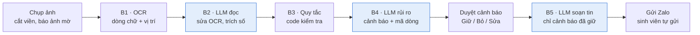

# App đọc hợp đồng thuê trọ cho sinh viên

> Sinh viên chụp hợp đồng thuê trọ (in hoặc viết tay). Trong vài phút, app chỉ ra điều khoản rủi ro hoặc còn thiếu, tô đúng dòng trên ảnh, giải thích bằng tiếng Việt dễ hiểu và soạn sẵn câu hỏi gửi chủ nhà.
>
> **App không phải tư vấn pháp lý.** Sinh viên duyệt từng cảnh báo trước khi gửi bất cứ điều gì.

**Trạng thái:** đã có bản thử nghiệm cục bộ trên nhánh `develop`: app Expo, API Hono, schema dùng chung. Google Vision và OpenAI đã chạy xuyên suốt trên 3 hợp đồng mô phỏng; trích số đúng 15/15 nhưng cảnh báo còn thừa và bỏ sót. Đã bổ sung [benchmark cảnh báo 24 ca](eval/benchmark/README.md) để đo và so sánh các lần sửa; nhãn mới là draft, chưa có holdout độc lập. Các mục bên dưới còn bao gồm kế hoạch tính năng.

**Chạy thử:** xem [docs/TRIAL.md](docs/TRIAL.md). Cài bằng `npm install`, chạy `npm run dev:api` và `npm run dev:web` trong hai terminal, mở `http://127.0.0.1:8081`.

Kế hoạch triển khai đề xuất, so sánh chiến lược và đánh giá độ khả thi: [docs/PLAN.md](docs/PLAN.md).

Bản kế hoạch cả nhóm cùng sửa và bình luận: [Claude Docs](https://claude.ai/artifact/K8m3iE7C2ruwwLZxEMVjci).

## Mục lục

1. [Bài toán và giá trị của AI](#1-bài-toán-và-giá-trị-của-ai)
2. [Quyết định kiến trúc: tô đúng dòng trên ảnh](#2-quyết-định-kiến-trúc-tô-đúng-dòng-trên-ảnh)
3. [Luồng xử lý](#3-luồng-xử-lý)
4. [Công nghệ và cấu trúc repo](#4-công-nghệ-và-cấu-trúc-repo)
5. [Bộ kiến thức](#5-bộ-kiến-thức-làm-trước-khi-viết-code)
6. [Triển khai](#6-triển-khai)
7. [Hướng dẫn viết prompt](#7-hướng-dẫn-viết-prompt)
8. [Đánh giá và AI có trách nhiệm](#8-đánh-giá-và-ai-có-trách-nhiệm)
9. [Quyết định và câu hỏi mở](#9-quyết-định-và-câu-hỏi-mở)
10. [Bắt đầu làm việc với repo](#10-bắt-đầu-làm-việc-với-repo)

## 1. Bài toán và giá trị của AI

- **Người dùng:** sinh viên lần đầu thuê trọ ở Hà Nội, không đủ tiền thuê luật sư, không biết thế nào là "bình thường".
- **Hậu quả cần tránh:** mất tiền cọc, tranh chấp tiền điện nước, sửa chữa, chấm dứt hợp đồng sớm.
- **Vì sao AI là thiết yếu:** bỏ AI đi thì sản phẩm không còn tồn tại. AI làm những việc sinh viên không tự làm được: đọc chữ viết tay, đối chiếu điều khoản với rủi ro, giải thích bằng chính số tiền của họ, soạn câu để thương lượng.
- **Ranh giới:** app không phải tư vấn pháp lý. Sinh viên duyệt từng cảnh báo trước khi gửi.

## 2. Quyết định kiến trúc: tô đúng dòng trên ảnh

Model AI đọc ảnh rất tốt nhưng không trả về vị trí trên ảnh đủ chính xác. Vì vậy ta chia việc cho OCR và LLM:

1. **OCR** đọc ảnh, trả về từng dòng chữ kèm vị trí. Mỗi dòng có một mã, ví dụ `p1-L12` (trang 1, dòng 12).
2. **LLM** nhận ảnh cùng danh sách dòng có mã, và chỉ trả lời bằng **mã dòng** cộng **câu trích nguyên văn**.
3. **App** dùng vị trí OCR đã lưu để tô sáng dòng đó trên ảnh.
4. **Code tự kiểm tra lại:** mã dòng có tồn tại không, câu trích có khớp với chữ trên dòng không. Không khớp thì hạ độ tin cậy hoặc bỏ cảnh báo. Đây là cách chặn AI bịa nội dung.

Cảnh báo loại "thiếu điều khoản" không có dòng để tô, nên hiển thị thành thẻ riêng kèm đề xuất câu nên bổ sung.

## 3. Luồng xử lý



Ô màu xanh là bước gọi LLM (3 lần). B1–B4 chạy ở backend ngay sau khi chụp. B5 chỉ chạy sau khi sinh viên duyệt xong, nên tin nhắn chỉ chứa những gì họ đã giữ. B3 là code thuần: việc tính được (số tháng cọc, giá điện vượt ngưỡng) thì để code làm cho ổn định và dễ giải thích.

## 4. Công nghệ và cấu trúc repo

Toàn bộ viết bằng TypeScript để app và backend dùng chung schema.

| Lớp | Đề xuất | Ghi chú |
| --- | --- | --- |
| App di động | Expo (React Native) + TypeScript, Expo Router | Demo nhanh trên điện thoại thật |
| Chụp tài liệu | react-native-document-scanner-plugin | Tự cắt viền, làm phẳng trang. Cần bản build riêng (không chạy trong Expo Go). Gấp thì bắt đầu bằng expo-image-picker |
| Tô sáng dòng | react-native-svg | Vẽ khung lên ảnh theo vị trí OCR |
| Backend | Node + Hono (TypeScript) | API key chỉ để ở backend, không bao giờ đưa vào app |
| OCR | Google Cloud Vision, chế độ `DOCUMENT_TEXT_DETECTION` | Đọc tiếng Việt có dấu và chữ viết tay. Kết quả chia theo từ, phải tự ghép thành dòng theo dấu xuống dòng (`detectedBreak`) |
| LLM | OpenAI Responses API, cấu hình qua `OPENAI_MODEL` | Dùng model hỗ trợ ảnh và Structured Outputs; đầu ra được kiểm tra bằng schema |
| Kiểm tra dữ liệu | Zod, dùng chung app và backend | |
| Lưu trữ | SQLite hoặc AsyncStorage trên máy | Bản hackathon không cần đăng nhập |
| Deploy backend | Render, Railway hoặc Cloud Run | |

```
apps/mobile/          # Expo app
apps/api/             # Backend Hono
packages/shared/      # Zod schema, code kiểm tra theo quy tắc (B3)
data/checklist.yaml   # Checklist quy tắc rủi ro
data/market_norms.yaml# Mức "bình thường" (điền sau khảo sát)
data/samples/         # Hợp đồng mẫu ĐÃ che thông tin (raw/ bị gitignore)
eval/                 # Bộ kiểm thử + nhãn đúng
prompts/              # 3 file prompt
docs/                 # Tài liệu thêm (slide, ảnh demo...)
```

## 5. Bộ kiến thức (làm trước khi viết code)

Chất lượng app phụ thuộc vào checklist nhiều hơn vào code.

- [ ] Thu 10–20 hợp đồng thật, có cả bản viết tay, che thông tin cá nhân. Dùng để kiểm thử và demo.
- [ ] Khảo sát mức "bình thường" ở Hà Nội: cọc mấy tháng, điện bao nhiêu một số, nước tính thế nào, phí dịch vụ. Lưu vào [`data/market_norms.yaml`](data/market_norms.yaml).
- [ ] Hoàn thiện checklist 15–20 quy tắc trong [`data/checklist.yaml`](data/checklist.yaml).
- [ ] Nhờ mentor hoặc sinh viên luật kiểm tra căn cứ pháp lý.

Checklist khởi đầu:

| Mã | Nhóm | Quy tắc | Mức |
| --- | --- | --- | --- |
| DEP-01 | Cọc | Không ghi điều kiện hoặc thời hạn trả cọc | Cao |
| DEP-02 | Cọc | "Mất cọc trong mọi trường hợp" khi trả phòng sớm, kể cả đã báo trước | Cao |
| DEP-03 | Cọc | Được trừ cọc vì "hư hỏng" nhưng không có biên bản bàn giao hiện trạng | Cao |
| DEP-04 | Cọc | Cọc cao bất thường so với mặt bằng | TB |
| UTL-01 | Điện nước | Ghi "giá điện theo chủ nhà quy định" hoặc cao hơn mức quy định cho người thuê | Cao |
| UTL-02 | Điện nước | Phí dịch vụ không ghi gồm những gì; nước tính theo người hay theo khối không rõ | TB |
| RNT-01 | Tiền thuê | Chủ nhà được tăng giá bất kỳ lúc nào, không báo trước | Cao |
| RNT-02 | Tiền thuê | Phạt chậm trả quá nặng | TB |
| REP-01 | Sửa chữa | Người thuê chịu mọi khoản sửa chữa, kể cả hư hỏng lớn hoặc hao mòn tự nhiên | Cao |
| TRM-01 | Chấm dứt | Chủ nhà được tự ý chấm dứt không cần báo trước, còn người thuê thì mất cọc | Cao |
| TRM-02 | Chấm dứt | Không ghi thời hạn báo trước | TB |
| OTH-01 | Khác | Không có danh sách đồ đạc hoặc biên bản hiện trạng | TB |
| OTH-02 | Khác | Chủ nhà được vào phòng bất kỳ lúc nào | TB |
| OTH-03 | Khác | Không rõ người cho thuê có phải chủ nhà thật không (có thể là người cho thuê lại) | TB |
| OTH-04 | Khác | Không nhắc tới đăng ký tạm trú | Thấp |

Căn cứ pháp lý để tham khảo (**cần kiểm tra số điều và hiệu lực** trước khi đưa vào app):

- Bộ luật Dân sự 2015: Điều 328 về đặt cọc, phần hợp đồng thuê tài sản từ Điều 472
- Luật Nhà ở 2023
- Luật Cư trú (đăng ký tạm trú)
- Quy định của Bộ Công Thương về giá điện cho người thuê nhà

## 6. Triển khai

Làm pipeline cho ra kết quả tốt trước, rồi mới làm giao diện đẹp.

### Lịch 7 ngày trước ngày thi

| Ngày | App | Backend + Prompt | Kiến thức + Thiết kế |
| --- | --- | --- | --- |
| N1 · 9/11 | Clone repo, chạy khung Expo | Khung API Hono, schema Zod | Thu hợp đồng mẫu, checklist bản đầu |
| N2 · 10/11 | Màn chụp nhiều trang | OCR + ghép dòng, LLM lần 1 | Khảo sát mức bình thường |
| N3 · 11/11 | Gọi API, màn chờ, danh sách kết quả | Quy tắc B3, LLM lần 2 | Phác giao diện, gắn nhãn bộ kiểm thử |
| N4 · 12/11 | Tô sáng dòng, màn duyệt cảnh báo | Kiểm tra mã dòng + câu trích, eval lần 1 | Nhờ mentor xem checklist |
| N5 · 13/11 | Màn tin nhắn, chia sẻ Zalo | LLM lần 3, deploy backend | Hoàn thiện giao diện |
| N6 · 14/11 | Ảnh xấu, lỗi mạng, câu miễn trừ | Che CCCD/SĐT, eval lần 2, tính năng thêm nếu kịp | Slide pitch |
| N7 · 15/11 | Đóng băng tính năng, build demo | Số liệu eval cho slide | Tập demo, cập nhật README |

### Các màn hình

1. Giới thiệu + câu "không phải tư vấn pháp lý" + xin đồng ý xử lý ảnh.
2. Chụp nhiều trang, báo chụp lại nếu ảnh mờ.
3. Đang phân tích: hiện từng bước "Đọc chữ → Trích điều khoản → Kiểm tra rủi ro".
4. Tổng quan: thẻ Tiền thuê / Cọc / Điện / Nước / Thời hạn / Báo trước, số cảnh báo theo mức độ.
5. Chi tiết cảnh báo: ảnh có dòng được tô, giải thích, mức bình thường, câu hỏi gợi ý, nút Giữ / Bỏ / Sửa.
6. Tin nhắn gửi chủ nhà: chọn cách xưng hô và giọng, sao chép hoặc gửi Zalo.

### Chia việc (nhóm 4 người)

| Vai | Thư mục chính | Việc chính |
| --- | --- | --- |
| App | `apps/mobile` | Expo, chụp ảnh, tô sáng, màn review, tin nhắn |
| Backend | `apps/api`, `packages/shared` | API, OCR, ghép dòng, code kiểm tra theo quy tắc, deploy |
| Prompt | `prompts`, `eval` | 3 prompt, schema, bộ kiểm thử, đo chỉ số |
| Kiến thức + Thiết kế | `data`, `docs` | Hợp đồng mẫu, khảo sát, checklist, giao diện, pitch |

### Tính năng thêm nếu còn thời gian

- **"Nếu… thì sao?"**: ví dụ "nếu tôi chuyển đi sau 4 tháng", app chỉ ra điều khoản liên quan và số tiền có thể mất.
- **Checklist ngày nhận phòng**: chụp số đồng hồ điện nước và hiện trạng phòng để bảo vệ tiền cọc.

## 7. Hướng dẫn viết prompt

Mỗi bước một prompt, mỗi prompt một khuôn mẫu đầu ra. Prompt đầy đủ nằm trong [`prompts/`](prompts/):

- [`01-extract.md`](prompts/01-extract.md): đọc & trích xuất (B2)
- [`02-risk.md`](prompts/02-risk.md): phân tích rủi ro (B4) + khuôn mẫu JSON cảnh báo
- [`03-message.md`](prompts/03-message.md): soạn tin nhắn (B5)

Nguyên tắc:

1. **Ép đầu ra bằng structured outputs (khai báo JSON schema)**, không chỉ ghi "hãy trả lời bằng JSON".
2. **Bắt buộc trích mã dòng kèm câu nguyên văn**, rồi để code kiểm tra lại.
3. **Cho phép AI nói "không biết"** (`not_found` / `unclear` / `[không đọc được]`). Đọc nhầm 3.500đ thành 35.000đ là sinh ra cảnh báo sai.
4. **Giải thích lý do cho mỗi quy tắc.** Model làm theo tốt hơn khi hiểu vì sao.
5. **Phần cố định đặt ở đầu system prompt** (checklist, mức bình thường), hợp đồng để sau, để phần đầu được lưu đệm: rẻ và nhanh hơn.
6. **Bọc hợp đồng trong thẻ `<contract>`** và nói rõ đó là dữ liệu, không phải lệnh.
7. **Chỉnh prompt dựa trên bộ kiểm thử**, không sửa theo cảm giác từ một ví dụ.

## 8. Đánh giá và AI có trách nhiệm

Nhóm tự đánh dấu "cảnh báo đúng phải có" cho mỗi hợp đồng mẫu (xem [`eval/`](eval/)), rồi chạy lại toàn bộ sau mỗi lần sửa prompt.

| Chỉ số | Cách đo |
| --- | --- |
| Bắt được cảnh báo mức Cao | Số cảnh báo Cao app tìm ra / số cảnh báo Cao nhóm đánh dấu |
| Cảnh báo thừa | Số cảnh báo app đưa ra nhưng nhóm cho là sai |
| Tô đúng dòng | Tỉ lệ cảnh báo có mã dòng đúng |
| Đọc đúng số tiền | Tỉ lệ tiền thuê, cọc, giá điện nước đọc đúng |

- Câu "không phải tư vấn pháp lý" ở màn giới thiệu và màn kết quả. Cảnh báo có độ tin cậy thấp ghi rõ "AI không chắc".
- Không gửi gì tự động. Sinh viên duyệt từng cảnh báo trước khi gửi.
- Che số CCCD và số điện thoại trước khi lưu; mặc định không giữ ảnh sau khi phân tích. **Không commit ảnh hợp đồng chưa che thông tin.**

Câu pitch: *"Bỏ AI đi thì sản phẩm không còn tồn tại."* Demo dùng 2–3 hợp đồng, trong đó có một bản viết tay, và bấm giờ từ lúc chụp đến lúc có tin nhắn.

## 9. Quyết định và câu hỏi mở

| Câu hỏi | Quyết định |
| --- | --- |
| Model bắt buộc? | Không. Chọn model OpenAI truy cập được qua `OPENAI_MODEL`; chưa xác minh model cho lần chạy thật |
| Ngôn ngữ | TypeScript (cả app và backend) |
| Thời gian | Chuẩn bị trước 1 tuần, được mang sản phẩm làm sẵn đến thi → hoàn thiện tối đa theo lịch 7 ngày |

Còn mở:

- [ ] Ngưỡng "cọc cao bất thường" và "giá điện cao" là bao nhiêu, sau khi khảo sát?
- [ ] Ai là mentor hoặc sinh viên luật kiểm tra checklist?
- [ ] Ngày thi chính xác?

## 10. Bắt đầu làm việc với repo

```bash
git clone <url-repo>
cd rental-contract-ai
cp .env.example apps/api/src/.env   # điền OPENAI_API_KEY, OPENAI_MODEL, Google Cloud credentials
```

Quy ước:

- Mỗi người làm trên nhánh riêng (`app/...`, `api/...`, `prompt/...`, `data/...`), mở Pull Request vào `main`.
- Không commit `.env`, API key, file service account, hay ảnh hợp đồng chưa che thông tin.
- Sửa prompt: chạy lại `eval/` và ghi chỉ số vào mô tả PR.
