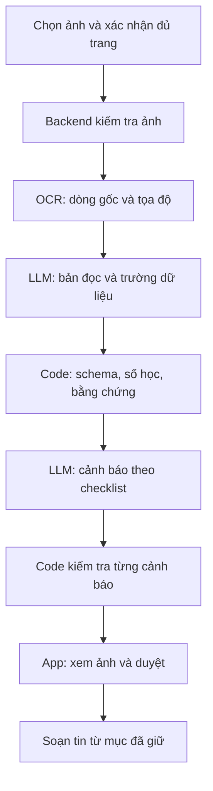

# Kế hoạch triển khai app đọc hợp đồng thuê trọ

Ngày lập: 09/11/2026. Cơ sở: cấu trúc repo, README, checklist và ba prompt hiện có.

Đây là đề xuất triển khai, chưa phải kết quả thực nghiệm. Thời gian, chỉ tiêu và mức khả thi bên dưới là giả định để nhóm ra quyết định; cần cập nhật sau hai ngày đầu.

## 1. Kết luận để bắt đầu

Nên làm một bản demo nhỏ nhưng chạy xuyên suốt: chọn ảnh hợp đồng → đọc thông tin → cảnh báo có bằng chứng → người thuê duyệt → tạo tin nhắn hỏi chủ nhà.

Với nhóm 4 người làm khoảng 5 giờ tập trung/người/ngày trong 7 ngày, bản demo này có khả năng hoàn thành nếu có tài khoản API ngay ngày đầu và ít nhất một người quen TypeScript/backend. Tổng năng lực khoảng 140 giờ công; dành khoảng 35 giờ cho tích hợp, lỗi và tập demo, còn khoảng 105 giờ xây dựng. Không coi 4 người là bốn luồng hoàn toàn độc lập vì app, schema và pipeline phụ thuộc nhau.

Nếu cả nhóm mới học công nghệ hoặc chỉ có 1–2 giờ/người/ngày, nên thu hẹp xuống bản tải ảnh và trả kết quả trên một giao diện đơn giản. Đánh giá riêng bản demo với sản phẩm cho người dùng thật: bản thứ hai còn cần nhiều vòng kiểm thử dữ liệu, vận hành và thử nghiệm người dùng.

Giá trị cần chứng minh: sinh viên hiểu được một điểm đáng hỏi trước khi ký và có thể kiểm tra lại nó trên hợp đồng. Không dùng số lượng cảnh báo làm thước đo thành công.

## 2. Hiện trạng và giả định

- Có mô tả sản phẩm, 15 quy tắc khởi đầu, ba prompt nháp và phân vai cho 4 người.
- App, API, schema và công cụ đánh giá chưa có phần triển khai trong các file đã đọc.
- Chưa có hợp đồng mẫu hoặc nhãn đúng; các mức tham chiếu thị trường đang để `null`.
- Giả định có thể thu ít nhất 10 hợp đồng đã che thông tin hoặc tạo hợp đồng mô phỏng có ghi rõ nguồn gốc. Các biến thể của cùng một hợp đồng không được chia sang cả bộ chỉnh prompt và bộ kiểm tra cuối.
- Giả định demo trên một điện thoại chính và có mạng; chưa đặt mục tiêu phát hành lên kho ứng dụng.
- Provider triển khai hiện tại là OpenAI, cấu hình `OPENAI_API_KEY` và `OPENAI_MODEL`. Trước khi tích hợp phải kiểm tra quyền truy cập, khả năng nhận ảnh và schema đầu ra bằng một yêu cầu thật; không xem tên model trong tài liệu là bằng chứng API đã dùng được.

## 3. Các chiến lược tiếp cận

| Hướng | Cách làm | Lợi thế | Rủi ro chính | Khi phù hợp |
| --- | --- | --- | --- | --- |
| A. LLM đọc trực tiếp ảnh | Một lời gọi trích thông tin và phân tích; lời gọi sau soạn tin | Nhanh có thử nghiệm để xem câu trả lời có hữu ích | Khó bảo đảm vị trí dòng; khó tách lỗi đọc chữ và lỗi suy luận | Thử trong vài giờ đầu, hoặc khi bỏ yêu cầu tô đúng dòng |
| B. OCR + LLM + code | OCR tạo dòng/vị trí; LLM trích thông tin; code kiểm tra; LLM giải thích | Có bằng chứng, dễ xác định lỗi, phù hợp mục tiêu repo | Nhiều bước, tăng thời gian chờ và công tích hợp | Hướng chính cho MVP có tô dòng |
| C. OCR + quy tắc là chính | Chuẩn hóa trường, dùng điều kiện và mẫu văn bản; LLM chủ yếu diễn đạt | Kiểm soát tốt phép tính và mẫu hợp đồng quen thuộc | Bỏ sót cách diễn đạt mới; khó hiểu ngoại lệ và điều kiện | Chức năng số học, hoặc tập hợp đồng có mẫu cố định |
| D. RAG trên tài liệu pháp lý | Tìm nguồn liên quan rồi đưa cho LLM phân tích | Có thể hỗ trợ truy nguồn khi bộ tài liệu được quản lý tốt | Phải quản lý hiệu lực, phạm vi áp dụng và độ đúng của truy xuất | Giai đoạn sau khi có bộ nguồn được kiểm tra |

Đề xuất: dùng A làm thử nghiệm đối chứng ngắn trên cùng ba mẫu, sau đó xây B, dùng C cho phần tính toán. Chưa đưa D vào đường triển khai 7 ngày: hiện nút thắt là đọc đúng hợp đồng và đánh giá cảnh báo, chưa có bằng chứng cần hệ thống tìm kiếm kiến thức.

Chỉ đổi model hoặc provider khi có lỗi cụ thể trên mẫu và so sánh cùng đầu vào. Mỗi thay đổi model phải chạy lại bộ đánh giá.

## 4. Phạm vi MVP

### Bắt buộc

1. Chọn/chụp 1–3 ảnh, xem trước, xóa và sắp xếp trang; hỗ trợ JPEG/PNG trong đường demo.
2. Trích tiền thuê, cọc, điện, cách tính nước, thời hạn thuê và thời hạn báo trước; biểu diễn được trạng thái không thấy/không đọc rõ.
3. Phân tích 8 quy tắc trọng tâm: DEP-01, DEP-02, DEP-03, UTL-01 (phần giá mơ hồ), RNT-01, REP-01, TRM-01 và TRM-02.
4. Mỗi cảnh báo có lý do, bằng chứng nếu tồn tại và câu hỏi cụ thể; phân biệt điều khoản rủi ro, mơ hồ và thiếu.
5. Chạm cảnh báo để xem đúng trang và vùng chữ; cảnh báo thiếu có thẻ riêng.
6. Người dùng giữ/bỏ cảnh báo, sửa câu hỏi; chỉ các mục đã giữ được dùng để soạn tin.
7. Sao chép tin nhắn; hiện lỗi và cho thử lại khi pipeline thất bại.

Giới hạn 1–3 ảnh là ràng buộc thử nghiệm, không được kết luận “thiếu điều khoản” nếu người dùng chưa xác nhận đã gửi đủ các trang và phụ lục liên quan.

### Làm nếu phần bắt buộc đã đạt

- Một mẫu viết tay rõ được kiểm thử riêng; không hứa hỗ trợ mọi kiểu chữ viết tay.
- Sửa số tiền đã trích rồi chạy lại kiểm tra phụ thuộc vào số đó.
- Quy tắc cọc cao hoặc giá điện vượt ngưỡng khi có dữ liệu tham chiếu phù hợp và nguồn xác minh.
- Chia sẻ qua menu hệ thống, thay vì phụ thuộc tích hợp riêng với Zalo.

### Để giai đoạn sau

Đăng nhập, đồng bộ lịch sử, chat mở, thanh toán, RAG pháp lý, tình huống “nếu… thì sao”, tự cắt/làm phẳng ảnh, nhận dạng mọi loại tài liệu và phát hành hai kho ứng dụng.

## 5. Kiến trúc và hợp đồng dữ liệu

Giữ cấu trúc TypeScript trong repo. App Expo gọi backend Hono; schema Zod nằm trong `packages/shared`. Khởi đầu bằng `expo-image-picker` để chọn/chụp ảnh; module này có trong Expo Go theo [tài liệu Expo](https://docs.expo.dev/versions/latest/sdk/imagepicker/). Chưa cần thêm scanner native vào đường triển khai đầu tiên.

Google Cloud Vision có `DOCUMENT_TEXT_DETECTION` cho tài liệu/chữ viết tay theo [tài liệu Google](https://docs.cloud.google.com/vision/docs/handwriting). Khả năng đọc đúng hợp đồng tiếng Việt của nhóm vẫn phải đo bằng dữ liệu thật.

### Dữ liệu cần thống nhất ngày đầu

| Đối tượng | Trường chính | Nguyên tắc |
| --- | --- | --- |
| Page | id, thứ tự, kích thước ảnh đã chuẩn hóa | OCR và app dùng cùng ảnh sau xử lý xoay/cắt |
| OcrLine | id, page_id, raw_text, polygon | Giữ nguyên bản OCR, không ghi đè |
| ReadLine | line_id, corrected_text, correction_status | Sửa OCR có dấu vết; số bị sửa cần xem lại |
| Term | value, unit, raw_text, line_ids, status | Tách giá trị khỏi đơn vị và độ chắc chắn |
| Flag | rule_id, type, severity, quote, line_ids, explanation, question | Có trạng thái kiểm chứng bằng chứng |
| Review | flag_id, keep/discard, edited_question | Quyết định của người dùng tách khỏi kết quả AI |

Chuẩn hóa polygon theo kích thước trang để app đổi tỷ lệ; tính cả khoảng trống khi ảnh hiển thị theo chế độ `contain`. Không dùng tọa độ do LLM tự tạo. Ảnh bị xoay sau OCR phải biến đổi polygon tương ứng hoặc OCR lại.

Backend sở hữu schema chạy thật; người Prompt cùng thống nhất ý nghĩa trường và tạo JSON mẫu. Đầu tiên chốt một response mẫu cho cả app và eval dùng, tránh mỗi người tạo một kiểu dữ liệu.

### Bằng chứng và lỗi đọc

- Kiểm tra line ID tồn tại và thuộc đúng trang; câu trích khớp văn bản đã chuẩn hóa khoảng trắng, không bỏ chữ số hoặc từ phủ định.
- So khớp với bản đọc đã sửa chỉ chứng minh AI trích nhất quán với bản đó, chưa chứng minh ảnh được đọc đúng. Luôn giữ OCR gốc để đối chiếu; thay đổi số tiền phải được đánh dấu.
- Bằng chứng không khớp: chuyển sang trạng thái cần xác minh, không tô một vùng tùy ý. App báo rõ có phần chưa phân tích đáng tin cậy.
- `missing` chỉ được kết luận khi đủ trang và vùng liên quan đọc được. Thiếu trang hoặc OCR lỗi thì trả `unclear`/chưa đủ dữ liệu.
- Không coi điểm `confidence` do LLM tự trả là xác suất đã được kiểm định. Trạng thái hiển thị dựa vào các kiểm tra cụ thể.
- Một cảnh báo cho mỗi vấn đề chính; gộp cảnh báo trùng nhưng giữ các bằng chứng liên quan.

### Hai API MVP

- `POST /analyze`: ảnh có thứ tự và xác nhận đủ trang → pages, terms, flags, trạng thái từng bước và phiên bản prompt/model/checklist.
- `POST /message`: các cảnh báo đã giữ cùng chỉnh sửa → tin nhắn và câu hỏi. Backend kiểm tra cấu trúc đầu vào; không tự thêm lại cảnh báo đã bỏ.

Đo thời gian trước khi thêm hàng đợi. Bản đầu có thể dùng request đồng bộ nếu thời gian đo nằm trong giới hạn hạ tầng; nếu vượt giới hạn, chuyển sang job ID và polling. Có timeout, lỗi từng bước và giới hạn thử lại. Mọi phản hồi từ model phải được validate, kể cả khi dùng structured outputs.

## 6. Cách bắt đầu để giảm rủi ro

Ưu tiên trả lời câu hỏi chưa chắc chắn nhất trước: “Pipeline có đọc đúng hợp đồng của nhóm và cho cảnh báo có căn cứ không?”

1. Chọn ba hợp đồng đầu: bản in dễ đọc có vấn đề, bản tương đối ổn và bản có câu mơ hồ; thêm trang viết tay nếu có. Ghi nhãn mong đợi trước khi xem AI trả lời.
2. Chạy OCR thật, xem riêng số tiền, thứ tự dòng và tọa độ. Không cần app đẹp để làm việc này.
3. Chạy trích xuất và phân tích trên cùng mẫu, lưu kết quả đã che thông tin để kiểm tra lại. So sánh nhanh với cách LLM đọc ảnh trực tiếp.
4. Dựng API thật trả một cảnh báo, app gọi được từ điện thoại. Hoàn thành đường này trước khi mở rộng số quy tắc.
5. Cho một bạn chưa tham gia viết prompt dùng thử: họ có tìm lại được câu trong hợp đồng và hiểu nên hỏi gì không?

Kết thúc ngày đầu phải có bằng chứng về chất lượng đọc và khả năng kết nối, không chỉ có các màn hình mẫu.

## 7. Phân việc và lịch 7 ngày

| Người/vai | Sở hữu | Sản phẩm bàn giao |
| --- | --- | --- |
| App | `apps/mobile` | Luồng chọn ảnh, kết quả, tô vùng, duyệt và sao chép |
| Backend | `apps/api`, `packages/shared` | Schema, OCR adapter, hai API, validator, triển khai |
| Prompt + Eval | `prompts`, `eval` | Adapter LLM theo schema đã chốt, prompt, script đánh giá, phân tích lỗi |
| Kiến thức + Thiết kế | `data`, `docs` | Mẫu đã che thông tin, nhãn đúng, checklist, thiết kế màn, thử người dùng và pitch |

Giao phần tích hợp LLM và đánh giá cho vai Prompt để giảm tải Backend. Backend review phần kết nối; hai bên không cùng sửa một adapter khi chưa thống nhất.

| Ngày | App | Backend | Prompt + Eval | Kiến thức + Thiết kế | Điều kiện kết thúc |
| --- | --- | --- | --- | --- | --- |
| N1 | Khung app, chọn ảnh, đọc JSON mẫu | Chốt schema, OCR trên ảnh thật | Kiểm tra model thật; thử ba mẫu | Ba mẫu và nhãn đầu, phác luồng | Một ảnh qua OCR/LLM có kết quả kiểm tra được; điện thoại gọi được API tối thiểu |
| N2 | Gửi ảnh, màn chờ/lỗi, kết quả | Nối `/analyze`, deploy bản sớm | Nối trích xuất/phân tích, eval cơ bản | Mở rộng dữ liệu lên ít nhất 5 mẫu | Một luồng thật từ điện thoại đến cảnh báo |
| N3 | Tô vùng, đổi trang | Quy tắc và validator bằng chứng | Chỉnh lỗi theo nhóm, chạy lại eval | Nhãn các trường hợp khó và bản ít rủi ro | Tô đúng câu trên nhiều kích thước màn hình |
| N4 | Giữ/bỏ, sửa câu hỏi | `/message`, timeout, thử lại | Prompt soạn tin, kiểm tra không thêm ý | Ít nhất 10 hợp đồng, khóa bộ kiểm tra cuối | Luồng từ chụp đến sao chép hoạt động |
| N5 | Thử trên điện thoại demo | Sửa lỗi tích hợp và đo độ trễ | Chạy bộ kiểm tra cuối, ghi cả lỗi | Thử với 3–5 sinh viên, sửa diễn đạt | Có báo cáo chất lượng và danh sách giới hạn |
| N6 | Chỉnh UX theo lỗi quan sát | Ổn định triển khai, giới hạn tải | Kiểm tra lại phần đã sửa | Demo script, slide, mẫu dự phòng | Đóng băng tính năng; diễn tập đủ luồng |
| N7 | Sửa lỗi chặn demo | Kiểm tra dịch vụ và credentials | Xác minh cấu hình cuối | Tập trình bày, ghi nhận giới hạn | Bản demo tái hiện được |

Mỗi ngày dành khoảng 15 phút ghép kết quả và xử lý phụ thuộc. App có thể dùng JSON mẫu khi backend chưa xong, nhưng trước cuối N2 phải thay bằng API thật.

Ước lượng công xây dựng để kiểm tra năng lực nhóm: schema/khung dự án 8 giờ, dữ liệu/nhãn 14, OCR/trích xuất 16, rủi ro/validator 15, app/tô vùng 22, duyệt/soạn tin 8, triển khai/eval/đo lường 17; tổng khoảng 100 giờ công. Khoảng 40 giờ còn lại trong giả định 140 giờ dành cho tích hợp, sửa lỗi và demo. Đây là ngân sách thời gian ban đầu, không phải cam kết tiến độ.

## 8. Đánh giá và mốc quyết định

Bộ 10 hợp đồng chỉ đủ tìm lỗi và báo cáo ban đầu. Gợi ý: 6 mẫu để chỉnh, 4 mẫu khóa để kiểm tra cuối; báo riêng số trường hợp và tử số/mẫu số, không tuyên bố tỷ lệ này đại diện cho mọi hợp đồng. Hai người thống nhất nhãn khó trước khi chấm AI.

Các mục tiêu sau là ngưỡng nội bộ đề xuất, chưa đo được:

| Nội dung | Cách đo | Mục tiêu demo |
| --- | --- | --- |
| Đọc số | Trường số đúng / trường số đọc rõ có nhãn | Ít nhất 95%; số sai phải được điều tra riêng |
| Bắt cảnh báo cao | TP / (TP + FN), ghép theo quy tắc và điều khoản | Ít nhất 90% trên phạm vi 8 quy tắc |
| Cảnh báo có ích | TP / (TP + FP), theo nhãn đã thống nhất | Ít nhất 85% |
| Bằng chứng | Cảnh báo có ID/quote hợp lệ / cảnh báo cần bằng chứng | 100% ở nhóm được hiển thị là đã kiểm chứng |
| Tô ảnh | Vùng tô đúng câu / các cảnh báo đã kiểm tra trực quan | Ít nhất 95%; báo cả số cảnh báo bị giữ lại vì không kiểm chứng được |
| Soạn tin | Đúng các mục được giữ và chỉnh sửa | Không thêm ý mới trong các tình huống kiểm tra |
| Thời gian | Từ gửi ảnh đến có kết quả, gồm OCR và LLM | Mục tiêu 60 giây cho bản in 1–3 trang; ghi từng lần chạy nếu ít mẫu |

Đo riêng ảnh rõ, ảnh khó và viết tay. Luồng yêu cầu chụp lại được ghi nhận là chưa hoàn tất phân tích; không loại bỏ các trường hợp đó để làm tỷ lệ đẹp hơn. Có trường hợp toàn hợp đồng ít rủi ro để phát hiện xu hướng báo động quá mức.

- **Cuối N1:** nếu chưa gọi được API hoặc OCR làm sai nhiều số tiền trên ảnh rõ, ưu tiên xử lý quyền truy cập và ảnh đầu vào; tạm dừng giao diện nâng cao.
- **Cuối N2:** nếu chưa có luồng thật, giảm còn một trang và vài quy tắc có bằng chứng; ghi rõ giới hạn một trang, không kết luận thiếu toàn hợp đồng.
- **Cuối N4:** nếu tô dòng chưa đáng tin, dùng câu trích kèm trang và ảnh đối chiếu trong bản demo, ghi rõ đây là phạm vi thu hẹp.
- **N5:** nếu bộ kiểm tra cuối còn cảnh báo bịa bằng chứng hoặc sai số tiền ảnh hưởng kết luận, chưa mở thử nghiệm rộng. Sửa lỗi; kết quả kiểm tra lại sau đó phải ghi là đã dùng để chỉnh.
- **Sau demo:** chỉ mở rộng khi người dùng hiểu cảnh báo, biết kiểm tra lại nguồn và nhóm có kế hoạch xử lý những lỗi quan sát được.

## 9. Chi phí, vận hành và xử lý dữ liệu

Không thể kết luận “rẻ” trước khi đo số token ảnh, số trang và số lần thử lại. Ghi chi phí từng bước trên 10 lượt chạy; dùng model thực sự có trong tài khoản và đơn giá hiện hành lúc triển khai.

`Chi phí một hợp đồng = OCR theo số trang + trích xuất LLM + phân tích LLM + xác suất người dùng soạn tin × chi phí soạn tin + phần thử lại + hạ tầng phân bổ.`

Đặt giới hạn số trang, dung lượng và số lần thử lại; chỉ chạy soạn tin khi được yêu cầu. Ghi thời gian, token, mã lỗi, phiên bản cấu hình; tránh log nội dung hợp đồng. Dùng bộ mẫu đã che thông tin cho demo, khóa API nằm ở backend. Không lưu ảnh lâu dài trong MVP; nếu phát sinh file tạm phải có bước dọn sau xử lý và khi lỗi.

Không đồng nhất “không lưu ở backend” với “không bên nào giữ dữ liệu”: trước khi dùng hợp đồng thật phải kiểm tra chính sách lưu giữ của provider. Chỉ che chữ OCR không làm ảnh đã che thông tin; đường xử lý ảnh cần được đánh giá riêng.

## 10. Độ khả thi theo kết quả mong muốn

| Kết quả | Đánh giá suy luận | Lý do/điều kiện |
| --- | --- | --- |
| Thử nghiệm phân tích vài ảnh, kiểm tra thủ công | Cao | Chưa phụ thuộc nhiều vào giao diện và tích hợp |
| Demo 7 ngày trên hợp đồng in rõ, 1–3 trang | Khá, có điều kiện | Cần schema ngày đầu, API ngày hai và giữ phạm vi 8 quy tắc |
| Đọc chữ viết tay bất kỳ và luôn tô đúng dòng | Thấp trong 7 ngày | Chưa có dữ liệu chứng minh OCR và liên kết vị trí đủ tốt |
| Bản thử nghiệm có người dùng ngoài nhóm | Trung bình sau khi đạt cổng chất lượng | Cần thêm dữ liệu, phản hồi và vận hành; chưa đủ căn cứ chốt thời gian |
| Kết luận đúng pháp lý cho mọi tình huống | Chưa đủ cơ sở | Checklist và nguồn hiện chưa được kiểm tra; phạm vi thực tế rộng hơn demo |

Rủi ro lớn nhất là chất lượng đầu vào và đánh giá sai độ tin cậy. Sau đó là khối lượng dồn lên Backend, thiếu dữ liệu đối chứng và tích hợp muộn. Các quyết định trong kế hoạch này nhằm xử lý lần lượt các rủi ro đó.

## 11. Danh sách việc mở ngay

- [ ] Chốt người cụ thể cho bốn vai và số giờ thực tế trong tuần.
- [ ] Có ba mẫu đã che thông tin, nhãn các số tiền và cảnh báo mong đợi.
- [ ] Xác minh credentials OCR và một model dùng được bằng lời gọi thật.
- [ ] Chốt schema cùng JSON mẫu; quy định ai sở hữu từng phần.
- [ ] Chạy một ảnh qua OCR → trích xuất → cảnh báo có câu trích.
- [ ] Kết nối điện thoại với API tối thiểu.
- [ ] Đo lần đầu: số sai, cảnh báo sai, bằng chứng sai, độ trễ và chi phí.
- [ ] Dùng kết quả ngày đầu để giữ hoặc giảm phạm vi, cập nhật kế hoạch.
