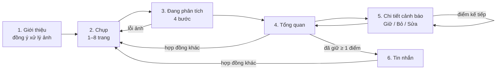

# Báo cáo phần App (apps/mobile)

Cập nhật: 10/11/2026 · Nhánh: `app/khung-app` · Vai: App

**Tóm tắt:** cả 6 màn hình trong kế hoạch đã có code, chạy trọn luồng bằng dữ liệu mẫu: giới thiệu → chụp → phân tích → tổng quan → chi tiết cảnh báo (tô đúng dòng trên ảnh) → tin nhắn gửi chủ nhà.

| Kiểm tra | Kết quả |
| --- | --- |
| TypeScript (`tsc --noEmit`) | 0 lỗi |
| Lint (`expo lint`) | 0 lỗi, 1 cảnh báo nhỏ trong file test |
| Test (`jest`) | 97/97 đạt, 5 bộ test |
| `expo-doctor` | 20/20 |
| Đóng gói thử (`expo export`) | Android và iOS đều thành công |
| **Chạy trên điện thoại thật** | **Chưa ai thử.** Xem [mục 7](#7-việc-cần-làm-tiếp) |

## 1. Các đầu việc và thư viện

| Đầu việc | Ai làm | Thư viện cài |
| --- | --- | --- |
| 1. Khung dự án | Phiên chính | `expo` (SDK 58), `react-native` 0.88, `react` 19.3, `typescript` 6, `expo-router` + `react-native-screens`, `react-native-safe-area-context`, `expo-linking`, `expo-constants`, `expo-status-bar`, `expo-splash-screen`, `expo-font`, `@expo/vector-icons` |
| 2. Schema dùng chung app–backend | Phiên chính | `zod` 4 (trong `packages/shared`) |
| 3. Bộ giao diện, kho trạng thái, lớp gọi API, dữ liệu mẫu | Phiên chính | `zustand` 5, `@react-native-async-storage/async-storage`, `expo-asset` |
| 4. Màn giới thiệu + chụp ảnh | Agent 1 | `expo-camera`, `expo-image-picker`, `expo-image-manipulator`, `expo-image`, `expo-haptics` |
| 5. Màn đang phân tích + tổng quan | Agent 2 | Không cài thêm |
| 6. Màn chi tiết + tô dòng trên ảnh | Agent 3 | `react-native-gesture-handler` 3, `react-native-reanimated` 4, `expo-image`, `expo-haptics` (`react-native-svg` đã cài nhưng không cần dùng) |
| 7. Màn tin nhắn gửi chủ nhà | Agent 4 | `expo-clipboard`, `expo-haptics`, `Share` có sẵn của React Native |
| 8. Ghép, sửa lỗi chéo, kiểm tra toàn bộ | Phiên chính | `jest` + `jest-expo`, `eslint` + `eslint-config-expo` (dev) |

Mọi thư viện cài bằng `npx expo install` để đúng phiên bản hợp với SDK 58, và đều có sẵn trong **Expo Go**, nên chưa cần build riêng.

**Các quyết định đã chốt khi làm:**

- **Chạy bằng Expo Go:** thử trên điện thoại ngay, không cần Android Studio.
- **Schema đặt ở `packages/shared`:** app và backend dùng chung một khuôn dữ liệu.
- **Giao diện tự viết bằng StyleSheet:** không thêm thư viện giao diện.
- **Làm trên nhánh riêng và mở Pull Request** để nhóm xem trước khi gộp.

## 2. Luồng màn hình

## 3. Từng màn hình

### Màn 1 · Giới thiệu (`src/app/index.tsx`)
- Tên app, một câu giới thiệu, 3 bước, câu "không phải tư vấn pháp lý".
- Ô đồng ý xử lý ảnh, ghi đúng sự thật: ảnh gửi lên máy chủ và dịch vụ AI để đọc; ảnh không vào thư viện ảnh của bạn; file tạm có thể còn trong bộ nhớ đệm.
- Lần đầu phải tick; lần sau không phải tick lại.

### Màn 2 · Chụp hợp đồng (`src/app/capture.tsx`, `src/components/capture/`, `src/lib/capture.ts`)
- **Camera:** toàn màn hình, có khung căn trang và 4 mẹo chụp. Chụp liền nhiều trang.
- **Thư viện ảnh:** chọn được nhiều ảnh một lúc.
- **Chuẩn hóa ảnh** trước khi lưu: cạnh dài tối đa 2000 px, JPEG chất lượng 0.8.
- **Danh sách trang:** đổi thứ tự, xóa, thay ảnh. Giới hạn 8 trang.
- **Nhắc nhẹ** khi ảnh quá nhỏ hoặc nằm ngang. Dán nhãn "Cần chụp lại" nếu backend báo trang đó không đọc được.
- **Chế độ dữ liệu mẫu:** có nút "Dùng hợp đồng mẫu".

### Màn 3 · Đang phân tích (`src/app/analyzing.tsx`)
- **4 bước:** gửi ảnh → đọc chữ → trích điều khoản → kiểm tra rủi ro. Có đếm giây đã chờ; sau 40 giây hiện câu trấn an. Không hiện phần trăm vì đó chỉ là ước lượng.
- **Hủy và nút Back của Android:** dừng yêu cầu rồi quay về màn chụp.
- **Khi lỗi:** hiện câu lỗi tiếng Việt, ghi rõ trang cần chụp lại, kèm nút "Thử lại" và "Chụp lại".

### Màn 4 · Tổng quan (`src/app/overview.tsx`, `src/components/overview/`, `src/lib/key-terms.ts`)
- **Tóm tắt:** số điểm theo mức độ và tiến độ "Đã xem x/N".
- **7 khoản chính:** tiền thuê, cọc, điện, nước, phí dịch vụ, thời hạn, báo trước.
  - Khoản không ghi hoặc ghi không rõ được tô nền vàng.
  - Tiền cọc ghi thêm "bằng/khoảng N tháng tiền nhà".
- **Danh sách cảnh báo:** nhóm theo mức độ, mỗi dòng ghi đã giữ / đã bỏ / chưa xem.
- **Nút ở đáy đổi theo tình huống:** chưa giữ điểm nào thì nút chính là "Xem điểm tiếp theo"; đã giữ ít nhất một điểm thì nút chính là "Soạn tin nhắn".

### Màn 5 · Chi tiết cảnh báo + tô dòng (`src/app/flag/[id].tsx`, `src/components/document/`, `src/lib/geometry.ts`)
- **Khung xem tập trung:** phóng vào đúng dòng bị cảnh báo, giữ vài dòng xung quanh, tô theo màu mức độ.
- **Trình xem cả trang:** chạm vào khung để mở. Chụm hai ngón để phóng (tối đa 6 lần), kéo, chạm hai lần để phóng nhanh. Mở ra là đã ở đúng dòng.
- **Cảnh báo nhiều trang:** mỗi trang một khung. Ảnh lỗi thì hiện chữ thay thế.
- **Cảnh báo "thiếu điều khoản":** không có ảnh, giải thích vì sao thiếu là đáng lo.
- **Câu hỏi gửi chủ nhà:** sửa được, khôi phục được câu gốc.
- **Nút Giữ / Bỏ:** bấm xong rung nhẹ và tự chuyển sang điểm chưa xem kế tiếp.
- **Toàn bộ phần tính toán vị trí khung tô** là hàm thuần, có 27 test: gộp nhiều dòng, dòng sát mép, trang dọc và trang ngang, cả 20 dòng của hợp đồng mẫu.

### Màn 6 · Tin nhắn gửi chủ nhà (`src/app/message.tsx`, `src/components/message/`, `src/lib/share.ts`)
- **Chọn cách xưng hô và giọng văn:**
  - xưng hô: em – anh/chị hoặc cháu – cô/chú;
  - giọng: nhẹ nhàng hoặc thẳng thắn.
- **Bản nháp sửa được**, khôi phục được bản gốc. Hỏi lại trước khi bỏ phần bạn đã sửa.
- **Câu hỏi và đề nghị ghi thêm vào hợp đồng:** mỗi câu chép riêng được.
- **Gửi:** "Sao chép" và "Chia sẻ" mở bảng chia sẻ của điện thoại, bạn tự chọn Zalo. **Ứng dụng không tự gửi gì**, và trên màn hình ghi rõ điều này.

## 4. Phần nền dùng chung

| File | Việc |
| --- | --- |
| `packages/shared/src/index.ts` | Schema Zod cho `POST /analyze` và `POST /message`. Vị trí dòng (`bbox`) chuẩn hóa về 0..1 theo kích thước ảnh |
| `src/lib/store.ts` | Kho trạng thái (Zustand) và các selector thuần: sắp xếp cảnh báo, tiến độ duyệt, điểm kế tiếp, các điểm đã giữ |
| `src/lib/api/` | `http.ts` gọi backend thật, `mock.ts` dùng dữ liệu mẫu. Đặt `EXPO_PUBLIC_API_URL` thì app tự chuyển sang backend thật |
| `src/mocks/` + `assets/samples/` | Hợp đồng mẫu 2 trang (tự tạo, không phải hợp đồng thật), có vị trí chính xác của 20 dòng và 11 cảnh báo mẫu đủ các loại |
| `src/components/ui/`, `src/theme/` | Nút, thẻ, nhãn mức độ, câu miễn trừ, bảng màu |

## 5. Lỗi đã tìm và sửa khi ghép

| Lỗi | Ai phát hiện | Đã sửa |
| --- | --- | --- |
| Đổi cách xưng hô khi app đang soạn tin thì kết quả cũ có thể đè lên kết quả mới (tin nhắn sai xưng hô) | Agent 4 | Mỗi lần soạn tin có số thứ tự; kết quả cũ bị bỏ. Thêm test |
| Bấm "Hủy" ở màn phân tích xóa luôn lỗi, nên màn chụp không biết trang nào cần chụp lại | Agent 1 | Store giữ lại lỗi khi hủy sau lỗi. Thêm test |
| "Kiểm tra hợp đồng khác" chồng thêm một màn chụp mới lên lịch sử điều hướng | Agent 2 và 4 | Đổi sang quay về màn chụp có sẵn (`router.dismissTo`) |
| README và chú thích code ghi "ảnh chỉ nằm trong bộ nhớ" là chưa đúng: file ảnh còn trong cache | Agent 1 | Sửa câu chữ cho đúng. Màn đồng ý đã viết đúng từ đầu |
| Hàm tính tiền cọc ghi "bằng 2 tháng" với 6.980.000đ / 3.500.000đ | Agent 2 | Chỉ ghi "bằng" khi khớp gần như chính xác, còn lại ghi "khoảng" |
| Hàm phóng ảnh khai báo sai thứ tự nên sẽ lỗi trên máy thật (test trên máy tính không bắt được) | Agent 3 | Đổi thứ tự, có ghi chú trong file |
| Hai bản React khác nhau trong dự án (19.3.0 và 19.3.1) | `expo-doctor` | Ép một bản qua `overrides` ở `package.json` gốc |

## 6. Cần nhóm quyết định hoặc xem lại

1. **Câu chữ** (nên để vai Kiến thức + Thiết kế duyệt): lời giải thích cho cảnh báo "thiếu điều khoản", các câu trấn an ở màn tổng quan, câu ở ô đồng ý.
2. **Xóa file ảnh tạm:** cần cài thêm `expo-file-system` để xóa ảnh khi bắt đầu hợp đồng mới. Nên làm, vì app hứa giữ quyền riêng tư.
3. **Tự cắt viền trang:** thử `CameraView.scanDocumentAsync()` của `expo-camera` trên Expo Go. Nếu chạy được thì ảnh gửi cho OCR sẽ tốt hơn nhiều mà không cần build riêng.
4. **Ngưỡng nhắc chất lượng ảnh** (cạnh dài < 1200 px…) và mốc "lâu quá" 40 giây chỉ là ước lượng; chỉnh lại khi có backend thật.
5. **Vuốt hoặc bấm Back của hệ thống ở màn tin nhắn** sẽ mất phần bạn đã sửa mà không hỏi lại.
6. **Chỉ tô được cả dòng OCR,** không tô được đúng cụm chữ, vì backend chỉ trả vị trí theo dòng.
7. **Báo cho vai Backend:** schema ở `packages/shared` do vai App viết trước để app chạy được với dữ liệu mẫu. Backend cứ sửa qua Pull Request, nhưng cần trả `bbox` chuẩn hóa 0..1 và `pages[].width/height` đúng kích thước ảnh đã dùng.

## 7. Việc cần làm tiếp

**Thử trên điện thoại thật** (Android và iPhone, qua Expo Go). Chưa ai làm, và đây là việc quan trọng nhất:

- [ ] Camera trong cửa sổ toàn màn hình, xin quyền, từ chối quyền rồi "Mở Cài đặt"
- [ ] Chọn nhiều ảnh, thứ tự ảnh, ảnh HEIC trên iPhone, ảnh xoay đúng chiều sau khi thu nhỏ
- [ ] Khung tô có trùng đúng chữ trên ảnh hợp đồng mẫu không
- [ ] Chụm, kéo, chạm hai lần trong trình xem cả trang; nút "Về dòng được tô"
- [ ] Bàn phím có che ô sửa câu hỏi hay ô sửa tin nhắn không
- [ ] Bảng chia sẻ có Zalo, dán sang Zalo giữ đúng xuống dòng
- [ ] Nút Back của Android ở màn phân tích, tổng quan, tin nhắn
- [ ] Màn nhỏ, cỡ chữ lớn, TalkBack / VoiceOver

**Sau đó:**

- [ ] Nối backend thật khi vai Backend có `POST /analyze` và `POST /message` (chỉ cần đặt `EXPO_PUBLIC_API_URL`)
- [ ] Xóa file ảnh tạm (mục 6.2), thử tự cắt viền (mục 6.3)
- [ ] Thêm test giao diện nếu còn thời gian (cần cài `@testing-library/react-native`)
